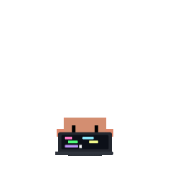
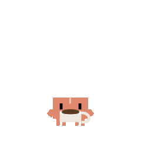
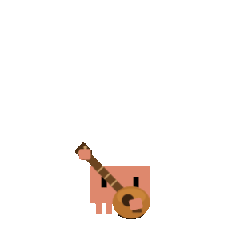
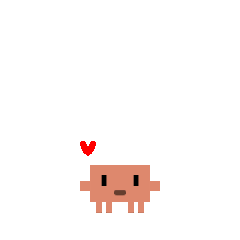
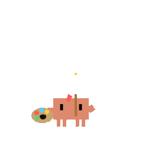
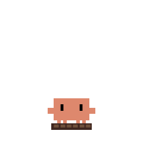
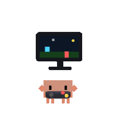
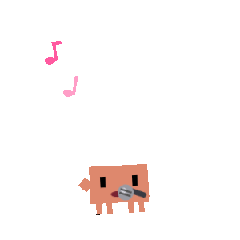

<p align="center">
  
  
  
  
</p>

<h1 align="center">ClawdPet</h1>

<p align="center">
  <strong>Your Multi-Agent AI coding buddy (Claude Code · Codex · Pi), alive on a tiny screen.</strong>
</p>

<p align="center">
  <a href="https://platformio.org"></a>
  
  
  
  <a href="LICENSE"></a>
</p>

---

A pixel-art cyber desk pet that lives on an **M5StickS3** and reacts to your **Claude Code**, **Codex**, and **Pi Coding Agent** sessions in real time. It tracks which tool is running, counts your tool combos, levels up as you code, and responds to physical tilt and flip gestures — all 100% silent and office-friendly.

<p align="center">
  
  
  
  
  
  
</p>

---

## Features

- 🐾 **Multi-Agent Live Sync** — Tracks **Claude Code (`C`)**, **Codex (`X`)**, and **Pi (`P`)** simultaneously with brand-colored capsules
- 🎬 **21 Pixel Animations** — Day/Night smart pools (`coding`, `gaming`, `singing`, `sleeping`, `listening`, `shower`, `coffee`, `guitar`, `dragon-boat`, etc.)
- ✨ **Stage Particle Engine & Day/Night Sky** — Matrix `0/1` bits when running commands, golden `+` sparks when editing files, floating `♥` hearts when fed, plus twinkling night stars & a pixel crescent moon after 21:00
- 🎮 **RPG Level & EXP System (`Lv.1 ~ Lv.99`)** — Earn EXP from tool calls, completed tasks, and focus sessions; unlock titles (`Novice` → `Coder` → `Hacker` → `Architect` → `Wizard` → `CyberGod`)
- 🔥 **Tool Combo & Live ECG Sparkline** — High-speed tool execution triggers `Nx COMBO!` badges and spikes the real-time activity heartbeat waveform in the bottom dock
- 📐 **Gravity Tilt Physics** — Tilt the device left or right and watch the pet, speech bubble, and particles slide with gravity
- 🍅 **Flip-to-Pomodoro (25m Focus Timer)** — Place the screen face-down for 1s and flip it back up to toggle a silent 25-minute Pomodoro timer (`P25:00`)
- 📊 **3-Page Cyber HUD** — `Pet Stage` → `Sessions & History` → `Compute Energy (Tokens & Agent Share)`
- 💾 **Persistent State** — Level, EXP, mood, streak, tasks, and sessions survive reboots via NVS flash storage

---

## How It Works

```text
Claude Code ──hook──┐
Codex CLI   ──hook──┼──► Daemon (TCP:8787) ──USB Serial──► M5StickS3 (135x240)
Pi Agent    ──ext───┘    aggregates state + tokens         renders pet + particles + HUD
```

---

## Quick Start

### 1. Flash the firmware

```bash
# Automatic port detection + daemon flash-lock guard
bash tools/flash.sh
```

### 2. Connect your AI Coding Agents

#### A. Claude Code (`~/.claude/settings.json`) & Codex (`~/.codex/hooks.json`)

Configure `PreToolUse`, `PostToolUse`, `UserPromptSubmit`, `Stop`, `SessionStart`, `SessionEnd` (and `Notification` for Claude Code) to invoke `tools/clawdpet_hook.py`:

```json
{
  "hooks": {
    "UserPromptSubmit": [{ "hooks": [{ "type": "command", "command": "python /path/to/ClawdPet/tools/clawdpet_hook.py" }] }],
    "PreToolUse":       [{ "hooks": [{ "type": "command", "command": "python /path/to/ClawdPet/tools/clawdpet_hook.py" }] }],
    "PostToolUse":      [{ "hooks": [{ "type": "command", "command": "python /path/to/ClawdPet/tools/clawdpet_hook.py" }] }],
    "Stop":             [{ "hooks": [{ "type": "command", "command": "python /path/to/ClawdPet/tools/clawdpet_hook.py" }] }],
    "SessionStart":     [{ "hooks": [{ "type": "command", "command": "python /path/to/ClawdPet/tools/clawdpet_hook.py" }] }],
    "SessionEnd":       [{ "hooks": [{ "type": "command", "command": "python /path/to/ClawdPet/tools/clawdpet_hook.py" }] }]
  }
}
```

#### B. Pi Coding Agent (`~/.pi/agent/extensions/clawdpet.ts`)

Copy `tools/clawdpet_pi_extension.ts` to `~/.pi/agent/extensions/clawdpet.ts`. It connects directly to `127.0.0.1:8787` over TCP with zero subprocess overhead.

---

## UI Layout (135×240 Cyber HUD)

```text
┌─────────────────────┐ y=0
│ 14:32  L5 ♥85  ⚡87% │  Top Bar: Time/Pomodoro | Level + Heart Mood | Battery + 1px EXP bar
├─────────────────────┤ y=18
│ ╭─────────────────╮ │
│ │🟣P ClawdPet >edit│ │  Top Session Pill: Agent badge (C/X/P) + Peacock bar + Project + Live Tool
│ ╰─────────────────╯ │
│   ✦        *    🌙  │  Ambient Stage: Day/Night sky + Matrix 0/1 & spark particles
│            [5x COMBO]│  Tool Combo badge
│     ╭─────────╮     │
│     │writing..│     │  Auto-width Speech Bubble (floats above pet's head, never blocks face)
│     ╰────v────╯     │
│        🐾           │  Unobstructed Pet Stage (slides with gravity tilt!)
├─────────────────────┤ y=202
│ ╭─────────────────╮ │
│ │ [C:1] [X:0] [P:1]│ │  Bottom HUD Dock Row 1: Claude (🟠) / Codex (🔵) / Pi (🟣) active capsules
│ │ OK:5  ─⋀⋁─   ●○○│ │  Bottom HUD Dock Row 2: Daily done | Live ECG Sparkline | Page dots
│ ╰─────────────────╯ │
└─────────────────────┘ y=240
```

### Physical Controls & Gestures (100% Silent)

- **BtnB click**: Cycle pages (`Pet Stage` → `Sessions & RPG Card` → `Tokens & Agent Share`)
- **BtnA short-press**: Poke the pet (`+5 mood`, `+3 EXP`, random animation from 10-emote pool + heart particles)
- **BtnA long-press**: Feed the pet (`+20 mood`, `+15 EXP`, eating animation + heart burst)
- **Tilt left / right**: Pet, bubble, and particles slide along gravity (`<< sliding` / `sliding >>`)
- **Flip face-down (1s) & back up**: Toggle 25-minute Focus Pomodoro countdown (`P25:00`, `+50 EXP` on completion)
- **Shake device**: Dizzy reaction (`-5 mood`)

---

## Project Structure

```text
ClawdPet/
├── src/main.cpp                   # Firmware (21 GIFs + Particle/Physics engine + 3-Page Cyber HUD)
├── src/anim/*.gif                 # 21 embedded pixel animations
├── tools/clawdpet_daemon.py       # PC daemon (serial + TCP + 3-agent state & token aggregation)
├── tools/clawdpet_hook.py         # Claude Code & Codex hook bridge (auto-detects agent + tool)
├── tools/clawdpet_pi_extension.ts # Native TypeScript extension for Pi Coding Agent
├── tools/clawdpet_send.py         # Manual control CLI
├── tools/task_state_manager.py    # Pure-logic multi-task state machine (unit-tested)
├── tools/flash.sh                 # One-click flash script with flash-lock protection
├── platformio.ini                 # Build config
└── LEARNING.md                    # Deep-dive engineering knowledge map
```

---

## Serial Protocol

```text
idle / working / choosing / done / all_done / error      → Switch pet state
#stat T=3 W=1 D=2 C=1 X=0 P=0                            → Total/Work/Done + per-agent active counts
#sess name:state:dur:color:agent:tool|...                → Active session details (C/X/P + live tool)
#hist agent~name:ago|...                                 → Recent completed sessions history
#today D=5 S=3                                           → Daily completion count + streak days
#combo N                                                 → Tool execution combo count & ECG pulse
#tok IN=N OUT=N CACHE=N C=N X=N P=N                      → Token usage + per-agent token breakdown
#time HH:MM                                              → Clock sync
#achv NAME                                               → Trigger achievement banner
#festival name                                           → Holiday greeting (5s)
ping                                                     → pong
```

---

## License

[MIT](LICENSE) — Venox
